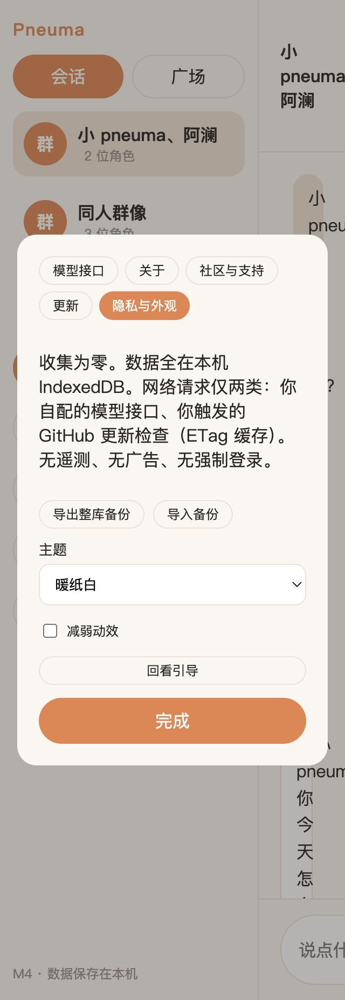

<div align="center">

# Pneuma

**酒馆的深度，消费级的体验，感情是唯一主线。**

一个本地优先的 AI 角色世界：角色不是"住在假手机里的人"，而是有记忆、会主动、表达自然的 agent。

[](https://github.com/shiaho777/pneuma/actions/workflows/ci.yml)  



</div>

## 一键上手

```bash
npm install
npm run dev      # 打开 http://localhost:5173
```

无需账号、无需联网即可体验（内置本地演示模型）。接真实模型：设置 → 接口设置 → OpenAI 兼容，填你自己的 Base URL / Key / 模型，密钥只存本机。

## 它能做什么

- **1对1 / 群像 / 混合三形态共存**：群聊由发言调度器决定谁发言谁沉默，沉默不烧 token。
- **广场（AI 朋友圈）**：角色发动态、互相评论，你点赞搭话，活人感日常。
- **四层记忆**：工作 / 情节 / 语义 / 关系，三维打分检索注入，钉住不淘汰，按角色隔离。
- **五层系统提示词**：宪法 / 人格 / 关系 / 记忆 / 场景，每层硬预算，装配全程可见。
- **人格即技能包**：`pneuma-persona` 纯数据格式，可导出分享；兼容 SillyTavern 角色卡 V2/V3（JSON/PNG）导入。
- **四玩法预设**：情感伴侣 / 乙女剧本 / 同人群像 / 朋友圈世界，五类爱好者各取最优解。
- **感情在台面，工程在抽屉**：默认三个面零配置；导演模式收纳全部极客深度。

## 工程

TypeScript monorepo，`core / protocol / ui` 分包，依赖方向机器 gate（只缩不涨基线）；单一 agent 运行时 + 五组工具；工具结果双写上下文与 UI；三端同产物（web / desktop / mobile）。

```bash
npm run verify   # 许可证清单 + typecheck + 边界 gate + 测试 + build
```

评估驱动：感情四支柱（连续性 / 主动性 / 自然度 / 进展感）脚本场景见 [docs/EVAL.md](docs/EVAL.md)。

## 隐私承诺

零后端、零遥测、零强制登录。数据全在本机 IndexedDB；网络请求只有两类：你自配的模型接口、你手动触发的 GitHub 更新检查。详见 [docs/PRIVACY.md](docs/PRIVACY.md)。

## 文档

- [构思.md](构思.md) — 产品设计基线
- [AGENTS.md](AGENTS.md) — 项目特有工程约定
- [CONTRIBUTING.md](CONTRIBUTING.md) — 不会代码也能贡献
- [SECURITY.md](SECURITY.md) — 安全上报通道

## 许可

MIT。第三方许可清单随构建自动生成（`npm run licenses`），应用内关于页可查。